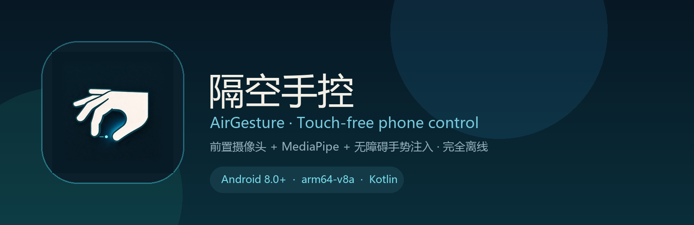
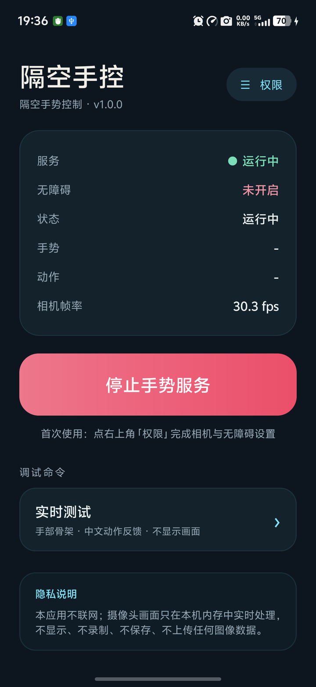
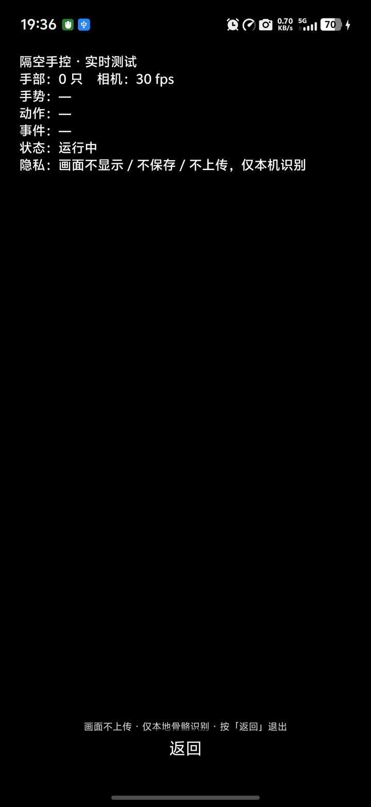
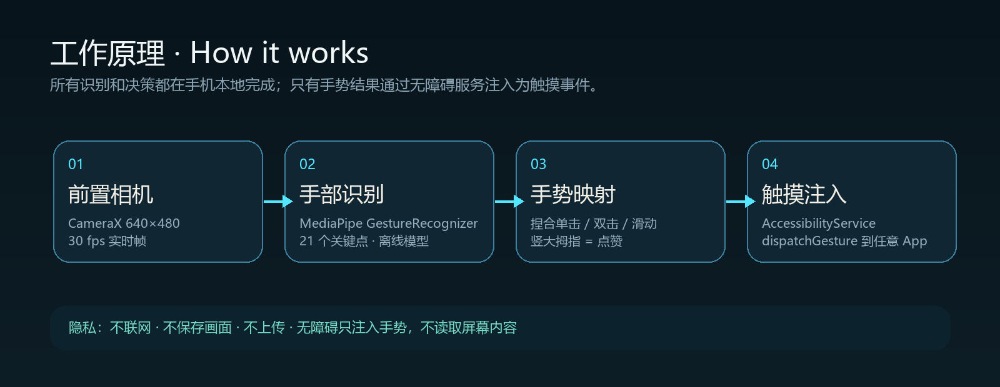

<div align="center">



# AirGesture

**Control your phone with hand gestures through the front camera — pinch to click, swipe, thumbs-up. Fully offline.**

[](https://developer.android.com)
[](https://kotlinlang.org)
[](https://developers.google.com/mediapipe)
[](#-privacy--security)
[](LICENSE)

[简体中文](README.md) · [English](README.en.md)

</div>

---

## What is this

**AirGesture** is an Android app that turns hand gestures into real touch events, completely on-device:

- Uses the **front camera** and MediaPipe to track 21 hand landmarks in real time;
- Maps gestures to **system-level touch events**, so it can control any app (WeChat, TikTok, Settings, browser…);
- Everything runs in memory on the phone — **no network, no screen recording, no storage, no uploads**.

No PC, no root, no wearable required.

## Demo

| Main screen | Live test (no camera preview, skeleton only) |
| --- | --- |
|  |  |

## Gestures

| Gesture | Action | Notes |
| --- | --- | --- |
| One short pinch (no drag) | **Single tap** | Taps the screen centre; waits 350 ms to make sure it is not a double tap |
| Two quick pinches | **Double tap** | Second pinch completes within 350 ms |
| Pinch + swipe up / down / left / right | **Swipe** | Keep pinching to chain multiple swipes |
| Thumbs-up held ~0.2 s | **Like** | Fires a double tap, 1.5 s cooldown |

> Open-palm arm/disarm, fist emergency stop and camera-cover stop were intentionally removed. The service is active as soon as it starts; stop it from the app. Fewer states, fewer false triggers.

## How it works



1. **CameraX** captures the front camera at 640×480 / ~30 fps, with rotation and mirroring handled;
2. **MediaPipe GestureRecognizer** runs on-device and outputs 21 hand landmarks plus built-in gesture labels;
3. **Gesture state machine**:
   - pinch ratio = distance(thumb tip #4, index tip #8) / hand scale;
   - pinch must be confirmed for 2 frames; a 180 ms guard window filters jitter right after pinching;
   - on release, a short, small-displacement pinch without a swipe becomes a "tap";
   - a second tap within 350 ms becomes a double tap, otherwise a single tap is emitted;
4. **AccessibilityService** injects the action via `dispatchGesture`, producing real touch events that work in any app.

## Privacy & Security

Privacy is the most important part of this project:

- **No INTERNET permission**: `android.permission.INTERNET` is not declared, so the app cannot access the network at the OS level;
- **No preview, no storage**: camera frames are processed in memory only — no preview surface, no files, no recording;
- **No uploads**: no network code, no analytics SDK, no third-party tracking;
- **Accessibility is injection-only**: the service only calls `dispatchGesture`; it does not read screen content, scrape nodes or listen to input;
- **Open source**: all code is in this repository and can be audited.

The only permissions requested are camera, notifications (foreground-service notification) and foreground service (camera type). The accessibility service must be enabled manually and can be revoked at any time.

## Quick start

**Requirements**: Android 8.0+ (API 26), arm64-v8a phone. A phone stand is recommended, with the front camera seeing one hand at 40–60 cm.

1. Download `隔空手控-v1.0.0-debug.apk` from [Releases](../../releases);
2. Open the app → **☰ Permissions** (top right) → grant camera / notification permissions;
3. Enable the **accessibility service** (if the toggle is greyed out, allow restricted settings in App info first);
4. Add the app to the **battery optimization whitelist** to keep the foreground service alive;
5. Return to the main screen and tap **Start gesture service**.

> Some secure screens (banking, payments, password entry) reject injected gestures; games and custom-drawn UIs may not respond to swipes.

## Build & test

Requires JDK 17, Android SDK 34 and Gradle 8.9 (a portable toolchain can be installed with `scripts/setup_android.ps1`):

```powershell
# Build the debug APK (output: dist\AirGesture-v1.0.0-debug.apk)
powershell -ExecutionPolicy Bypass -File scripts\build_apk.ps1

# Run the 17 gesture state-machine JVM tests
powershell -ExecutionPolicy Bypass -File scripts\test_android.ps1
```

Key code:

| Path | Responsibility |
| --- | --- |
| `android/app/src/main/java/.../perception/` | CameraX/MediaPipe integration, dynamic gesture state machine |
| `android/app/src/main/java/.../mapping/GestureGate.kt` | Gesture→action mapping (tap/double-tap window, like, swipe cooldown) |
| `android/app/src/main/java/.../action/` | Accessibility service and touch injection |
| `android/app/src/main/java/.../service/` | Foreground service (camera + recognition + notification) |
| `android/app/src/main/java/.../MainActivity.kt` | Dark main screen, permissions drawer, status panel |

## Known limitations

- Single-hand recognition only, fixed thresholds, no sensitivity UI yet;
- Tap/double tap target the **screen centre** (there is no cursor layer, so it is not "point where you look");
- `arm64-v8a` only; debug signing (configure your own release keystore for distribution);
- The accessibility service must be enabled manually; some secure screens block injection;
- Front-camera FOV/angle may need recalibration on other devices.

## License

[MIT](LICENSE) © 2025 AirGesture

---

<div align="center">

**If this project helps you, please consider giving it a ⭐ Star.**

</div>

