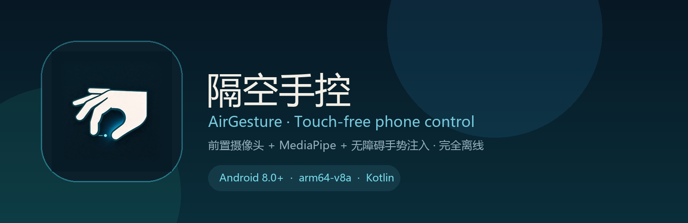
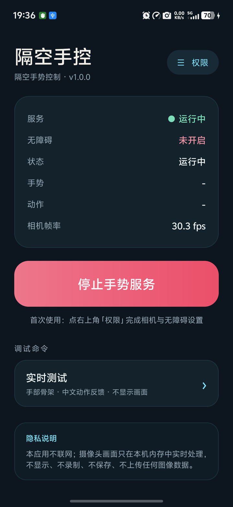
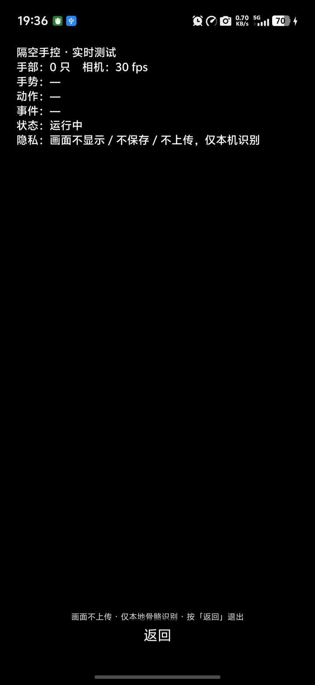
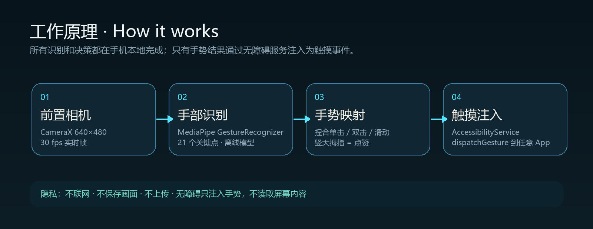

<div align="center">



# 隔空手控 · AirGesture

**用前置摄像头隔空控制手机 —— 捏合单击、滑动、点赞，完全离线。**

[](https://developer.android.com)
[](https://kotlinlang.org)
[](https://developers.google.com/mediapipe)
[](#-隐私与安全)
[](LICENSE)

[简体中文](README.md) · [English](README.en.md)

</div>

---

## 这是什么

**隔空手控**是一个完全运行在 Android 手机本地的隔空手势控制 App：

- 用**前置摄像头**实时识别手部 21 个关键点；
- 把手势映射成**系统级触摸事件**，可以操作任意 App（微信、抖音、设置、浏览器……）；
- 所有识别、判断都在手机内存中完成，**不联网、不录屏、不保存、不上传**。

不需要电脑、不需要 root、不需要可穿戴设备。

## 演示

| 主界面 | 实时测试（不显示画面，只显示骨架） |
| --- | --- |
|  |  |

## 手势

| 手势 | 动作 | 说明 |
| --- | --- | --- |
| 捏合一次（短促、不拖动） | **单击** | 打在屏幕中心；会等 350ms 确认不是双击 |
| 快速捏合两次 | **双击** | 350ms 内完成第二下 |
| 捏住并上 / 下 / 左 / 右甩 | **滑动** | 捏住不松手可以连续甩 |
| 竖大拇指保持约 0.2 秒 | **点赞** | 触发一次双击，冷却 1.5 秒 |

> 已刻意去掉「张开手掌激活/待机」「握拳急停」「遮镜头急停」等状态：服务启动即生效，停止由 App 按钮完成，规则越少越不容易误触。

## 工作原理



1. **CameraX** 以 640×480 / 约 30fps 采集前置相机帧，自动旋转并镜像；
2. **MediaPipe GestureRecognizer** 在端内推理，输出 21 个手部关键点和内置手势类别；
3. **手势状态机**：
   - 捏合距离用 `拇指尖(4)` 与 `食指尖(8)` 的距离 / 手掌尺度判断；
   - 捏合确认 2 帧进入，180ms 保护窗口过滤刚捏住时的抖动；
   - 松手时若时间短、位移小、且没有甩动，判定为一次「点按」；
   - 350ms 内出现第二次点按 → 双击，否则落成单击；
4. **AccessibilityService** 用 `dispatchGesture` 把动作注入为真实触摸事件，因此可以操作任意 App。

## 隐私与安全

这是本项目最重视的部分：

- **没有 INTERNET 权限**：`AndroidManifest.xml` 中没有 `android.permission.INTERNET`，App 从系统层面无法联网；
- **画面不显示、不保存**：相机帧只在内存中处理，不做预览、不写文件、不录屏；
- **不上传**：没有网络代码、没有统计 SDK、没有第三方分析；
- **无障碍只做注入**：AccessibilityService 只调用 `dispatchGesture` 注入点击/滑动，不读取屏幕内容、不抓取控件、不监听输入；
- **开源可查**：所有代码都在本仓库，任何人都可以审查。

App 需要的权限只有：相机、通知（前台服务常驻通知）、前台服务（camera 类型）。无障碍服务需手动开启，可随时关闭。

## 快速开始

**要求**：Android 8.0+（API 26），arm64-v8a 手机；建议把手机固定在支架上，前置摄像头可拍到单手（40–60cm）。

1. 从 [Releases](../../releases) 下载 `隔空手控-v1.0.0-debug.apk` 安装；
2. 打开 App → 右上角 **☰ 权限** → 授予相机 / 通知权限；
3. 开启**无障碍服务**（若开关是灰色，先在「应用信息」里允许受限设置）；
4. 建议把 App 加入**电池优化白名单**，避免后台被杀；
5. 回到主界面点 **启动手势服务**，允许通知即可开始。

> 部分安全界面（银行、支付、密码输入）会拒绝注入；游戏/自绘界面也可能不响应滑动。

## 构建与测试

需要 JDK 17、Android SDK 34、Gradle 8.9（仓库 `scripts/setup_android.ps1` 可安装便携工具链）：

```powershell
# 构建 debug APK（输出 dist\隔空手控-v1.0.0-debug.apk）
powershell -ExecutionPolicy Bypass -File scripts\build_apk.ps1

# 运行 17 项手势状态机 JVM 单元测试
powershell -ExecutionPolicy Bypass -File scripts\test_android.ps1
```

核心代码：

| 路径 | 职责 |
| --- | --- |
| `android/app/src/main/java/.../perception/` | CameraX/MediaPipe 接入、动态手势状态机 |
| `android/app/src/main/java/.../mapping/GestureGate.kt` | 手势 → 动作映射（单击/双击窗口、点赞、滑动冷却） |
| `android/app/src/main/java/.../action/` | 无障碍服务与触摸注入 |
| `android/app/src/main/java/.../service/` | 前台服务（相机 + 识别 + 通知） |
| `android/app/src/main/java/.../MainActivity.kt` | 深色主界面、权限侧边栏、状态面板 |

## 已知限制

- 仅支持**单手**识别，固定阈值，暂无灵敏度调节 UI；
- 单击/双击落在**屏幕中心**（没有光标层，不能"点哪指哪"）；
- 仅 `arm64-v8a`；debug 签名（正式发布需自行配置 release keystore）；
- 无障碍服务需手动开启，部分安全界面会屏蔽注入；
- 不同机型的前置摄像头 FOV/角度可能需要重新标定。

## License

[MIT](LICENSE) © 2025 AirGesture

---

<div align="center">

**如果这个项目对你有帮助，欢迎点一个 ⭐ Star。**

</div>
